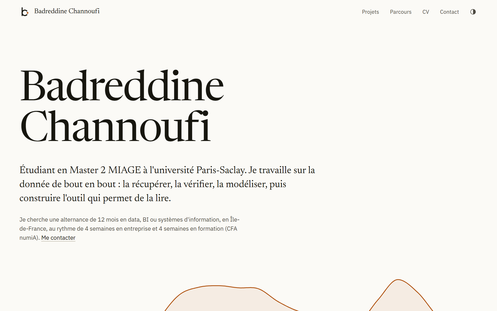

<p align="center">
  
</p>

<h1 align="center">Badreddine Channoufi</h1>

<p align="center">
  Le site personnel d'un étudiant en Master 2 MIAGE à l'université Paris-Saclay :<br>
  des projets data présentés comme de courts articles illustrés, le parcours et le CV.
</p>

<p align="center">
  <a href="https://badreddine05.github.io/"><strong>badreddine05.github.io</strong></a>
  &nbsp;·&nbsp;
  <a href="https://badreddine05.github.io/cv.html">CV</a>
  &nbsp;·&nbsp;
  <a href="https://www.linkedin.com/in/badreddine-channoufi-693488208/">LinkedIn</a>
</p>

<picture>
  <source media="(prefers-color-scheme: dark)" srcset=".github/readme/portfolio-dark.png">
  
</picture>

## Les projets

| Projet | Étude de cas | Application | Code |
| --- | --- | --- | --- |
| RetailScope : ventes et fidélité d'un commerce en ligne | [lire](https://badreddine05.github.io/projets/retailscope/) | [ouvrir](https://badreddine05.github.io/retailscope/) | [retailscope](https://github.com/Badreddine05/retailscope) |
| GridPulse : l'électricité française heure par heure, 2023-2024 | [lire](https://badreddine05.github.io/projets/gridpulse/) | [ouvrir](https://badreddine05.github.io/gridpulse/) | [gridpulse](https://github.com/Badreddine05/gridpulse) |
| FlowLens : le parcours de 31 509 demandes de prêt | [lire](https://badreddine05.github.io/projets/flowlens/) | [ouvrir](https://badreddine05.github.io/flowlens/) | [flowlens](https://github.com/Badreddine05/flowlens) |
| NeuroLab : reconnaître un mouvement imaginé dans l'EEG | [lire](https://badreddine05.github.io/projets/neurolab/) | dans l'étude | [BCI](https://github.com/Badreddine05/BCI) |

Chaque étude de cas se lit comme un article de recherche : des figures numérotées et interactives, des notes en marge, puis la méthode, les limites et les sources en annexe. Les figures sont calculées à partir des données des projets, avec leur propre code d'analyse, si bien que les chiffres de l'article et de l'application sont les mêmes.

## Les jeux

| Jeu | Jouer | Code |
| --- | --- | --- |
| Frogger : traverser une route puis une rivière, moteur Java compilé par TeaVM | [jouer](https://badreddine05.github.io/frogger/) | [Frogger](https://github.com/Badreddine05/Frogger) |
| L'Île interdite : jeu coopératif de 2 à 4 joueurs, moteur Java compilé par TeaVM | [jouer](https://badreddine05.github.io/ile-interdite/) | [Projet-le-interdite-](https://github.com/Badreddine05/Projet-le-interdite-) |
| REBOUND : casse-briques en OCaml, compilé avec js_of_ocaml | [jouer](https://badreddine05.github.io/rebound/) | [Casse-brique](https://github.com/Badreddine05/Projet-programmation-Fonctionnelle-avanc-e-Casse-brique) |

Dans chaque jeu, la page web utilise le moteur testé du projet, compilé en JavaScript. Les builds intégrés ici sont épinglés par `games.lock.json`, avec l'empreinte SHA-256 de chaque moteur compilé.

## Le site

Le site est statique : du HTML, du CSS et un peu de JavaScript, publiés par GitHub Pages depuis la branche `main`, sans étape de compilation. Il suit le thème clair ou sombre du système, et un bouton permet de le forcer pour tout le site, applications comprises. L'identité graphique (polices, couleurs, marques, règles de mise en page) est décrite dans [docs/design-system.md](docs/design-system.md).

Pour le voir en local :

```sh
python -m http.server 8080
```

puis ouvrir `http://localhost:8080/`. La mise à jour des figures, des applications et du CV est décrite dans [docs/maintenance.md](docs/maintenance.md).

## Licences et crédits

Code du site sous licence [MIT](LICENSE). Polices Newsreader, IBM Plex Sans et IBM Plex Mono sous SIL OFL 1.1 (`assets/fonts/`) ; D3 sous licence ISC (`assets/vendor/`). Les données de chaque projet gardent leurs propres conditions, détaillées dans son dépôt ; celles du BPI Challenge 2017 (FlowLens) interdisent l'usage commercial.

Les années des jeux de données ne sont pas des dates de développement, et les commits portent leurs dates réelles. Le site et les projets ont été réalisés avec l'aide d'outils d'IA ; les sources et les contrôles sont documentés dans chaque dépôt. Le contenu du CV et les coordonnées ne doivent pas être réutilisés pour se faire passer pour leur auteur.
